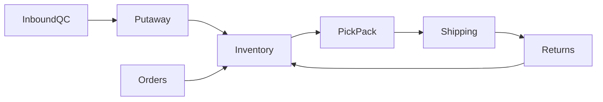

# ระบบ Fulfillment ปฏิบัติงาน (WMS Demo)

โปรเจกต์ปัจจุบันเป็น Next.js 16.4.4 starter ([`app/page.tsx`](app/page.tsx), [`app/layout.tsx`](app/layout.tsx), Tailwind v4) ยังไม่มีโมดูลคลัง แผนนี้จะแทนที่หน้าเริ่มต้นด้วยคอนโซลปฏิบัติงานจริง ไม่ใช่หน้าขายของ

**ขอบเขต v1:** ระบบใช้งานได้ครบวงจรด้วยข้อมูลจำลองในเบราว์เซอร์ (seed + `localStorage`) สแกนบาร์โค้ดจำลองด้วยคีย์บอร์ด/ช่องกรอก คำสั่งซื้อและขนส่งเป็นการจำลอง Shopee / Lazada / TikTok / Flash / J&T / SPX / ไปรษณีย์ไทย **ไม่ต่อ API จริง** ในรอบนี้ เพื่อให้ 6 ขั้นตอนต่อกันได้ทันที

## Design system

ใส่โทเคนใน [`app/globals.css`](app/globals.css) ผ่าน Tailwind v4 `@theme` — ปิด `prefers-color-scheme: dark` ของ starter เพราะแบรนด์คือพื้นขาว + โซนมืดเฉพาะส่วน

- Ink `#171717` พื้นมืด / ตัวอักษรหลัก
- Gold `#c6a15b` ปุ่มหลัก ไฮไลต์
- Gold deep `#8a6a32` ลิงก์บนพื้นสว่าง
- Silver `#e6e6e6` พื้นสลับ section / ขอบอินพุต
- Silver metal `#b9b9b9` เส้นแบ่งรอง
- Muted `#5e5e5e` คำบรรยาย
- White `#ffffff` พื้นหลัก
- แดง/เขียว ใช้เฉพาะ error / success (เช่น สแกนผิด, QC ผ่าน)

จับคู่: พื้นขาว + ตัวอักษร ink + คำอธิบาย muted; ปุ่มหลักพื้นทองตัวอักษร ink; โซนมืด ink + ขาว + accent ทอง

ฟอนต์: เปลี่ยนจาก Geist (ไม่มีไทย) เป็น `Noto Sans Thai` + `Noto Sans` ผ่าน `next/font/google`

คอมโพเนนต์ UI ร่วมใน `components/ui/`: `Button`, `StatusBadge`, `ScanInput`, `DataTable`, `Card`, `Modal`, `Toast` (แดง/เขียวเฉพาะผลสแกน)

## Information architecture

สองเลย์เอาต์: คอนโซลเดสก์ท็อป และ PDA สำหรับพนักงานคลัง

**เดสก์ท็อป** (`components/layout/AppShell.tsx`): ไซด์บาร์ + ท็อปบาร์ (สลับภาษา TH/EN, โหมด PDA)

- `/` แดชบอร์ดท่อ 6 ขั้นตอน + KPI สด (รอรับ, กักกัน, พร้อมขาย, ค้างหยิบ, ค้างส่ง, ตีกลับ)
- `/inbound` รายการ ASN/PO
- `/inbound/[id]` รับสินค้า เทียบยอด discrepancy / QC
- `/putaway` คิวจัดเก็บ + แผนที่พิกัด
- `/inventory` สต็อกตามโลเคชัน/ล็อต FIFO-FEFO
- `/orders` ออเดอร์ทุกช่องทาง + ล็อกสต็อก
- `/pick` เวฟหยิบ + เส้นทาง
- `/pack` ตรวจสแกนที่โต๊ะแพ็ก + พิมพ์ใบปะหน้าจำลอง
- `/shipping` คัดแยกขนส่ง + ใบส่งมอบ + เซ็นดิจิทัล
- `/returns` รับคืน เกรดสภาพ restock / RTV

**PDA** (`/pda/*` + `PdaShell`): ปุ่มใหญ่ โฟกัสช่องสแกน มีแผงรหัสตัวอย่างให้ทดลองพิมพ์

- `/pda/receive` `/pda/putaway` `/pda/pick` `/pda/pack` `/pda/stage` `/pda/returns`

สลับภาษา: dictionary ใน [`lib/i18n/dict.ts`](lib/i18n/dict.ts) + React context เก็บ `th | en` ใน `localStorage` ตั้ง `html lang` ตามภาษา ป้ายทุกหน้ามีทั้งไทยและศัพท์เทคนิคอังกฤษ

## โมเดลข้อมูลและสถานะ

ไฟล์หลัก: [`lib/types.ts`](lib/types.ts), [`lib/seed.ts`](lib/seed.ts), [`lib/store.ts`](lib/store.ts) (Zustand + persist)

เอนทิตีที่ต้องมีเพื่อให้ท่อเดินได้:

- `Sku`, `Lot` (รับเข้า / หมดอายุ สำหรับ FIFO/FEFO)
- `Location` แบบ `Zone-Aisle-Rack-Shelf-Bin` เช่น `A-01-02-3-B`
- `Asn` + `AsnLine` สถานะ `expected → receiving → qc → putaway_ready → closed`
- `InventoryBalance`: `onHand`, `reserved`, `quarantine`, `available`
- `SalesOrder` จากช่องทาง `shopee | lazada | tiktok | website` สถานะ `paid → allocated → picking → packing → packed → staged → handed_over`
- `PickWave`, `PickTask` (ลำดับเดิน shortest-path ตามพิกัด)
- `Shipment` + `Carrier` (`flash | jnt | spx | thailand_post`) + `Manifest`
- `ReturnCase` สถานะ `intake → graded → restocked | rtv | destroy`

กติกาธุรกิจใน `lib/engine/`:

- รับเข้า: สแกนแล้วเทียบ ASN ถ้าขาด/เกิน เขียน `DiscrepancyLog`
- QC ไม่ผ่าน → `Hold / Quarantine` ไม่เข้า `available`
- Directed putaway: แนะนำช่องจากขนาด/น้ำหนัก/`velocity` (fast-moving ชั้นหยิบง่าย)
- บังคับสแกนคู่ SKU + บาร์โค้ดช่องก่อนลงพิกัด
- ออเดอร์ชำระแล้ว `reserve` ทันที กัน overselling ทุกช่องทาง
- จัดสรรล็อต FEFO ถ้ามีวันหมดอายุ ไม่งั้น FIFO
- แพ็ก: สแกนไม่ตรงรุ่น/สี/ไซส์ → เสียงเตือน + ไฟแดง + ไม่ออกเลขพัสดุ
- สแกนครบกล่อง → สร้าง tracking จำลอง + ใบปะหน้าบนหน้าจอ (print dialog)
- คัดแยกตามขนส่งและ cut-off → ใบส่งมอบให้เซ็นบนหน้าจอ → ดันสถานะกลับไปที่ออเดอร์แพลตฟอร์มจำลอง

## หน้าจอหลักของแต่ละโมดูล

**1. Inbound & QC** — ตาราง ASN, เปิดใบรับ, สแกนทีละชิ้น/กล่อง, แถบ expected vs received, ปุ่ม QC pass/fail, โซนกักกันแยกจากสต็อกขาย

**2. Putaway** — คิวสินค้าที่ผ่าน QC, ระบบแนะนำช่องบน PDA, สแกนสินค้าแล้วสแกนป้ายช่อง, อัปเดตแผนที่คลังแบบเรียลไทม์บนเดสก์ท็อป

**3. Orders & Inventory** — ปุ่ม “ซิงก์ออเดอร์” ดึง seed ออเดอร์เข้าคิว, ล็อกสต็อกทันที, หน้าสต็อกแสดง available/reserved/quarantine และล็อตที่จะถูกหยิบ

**4. Pick & Pack** — สร้างเวฟตามประเภท (ซองเล็ก / กล่องใหญ่), PDA แสดงจุดหยิบเรียงเส้นทาง, โต๊ะแพ็กบังคับสแกนซ้ำ, สำเร็จแล้วโชว์ใบปะหน้าและสั่ง `window.print()`

**5. Shipping** — กรง Flash / J&T / SPX / ไปรษณีย์, สแกนลงกรงตาม cut-off, เจน manifest, ช่องเซ็นชื่อคนขับ, อัปเดต tracking บนการ์ดออเดอร์

**6. Returns** — สแกนใบปะหน้าเดิมดึงออเดอร์, เกรด 100% / แพ็กใหม่ / เสียหาย, สภาพดี putaway กลับ bin เดิมและคืนสต็อก, เสียหายเข้าโซนทำลายหรือ RTV

แดชบอร์ด `/` สรุป 6 ขั้นตอนเป็นแถบท่อคลิกเข้าโมดูลได้ (คงเจตนารมณ์ “สรุป workflow” ไว้บนระบบปฏิบัติงาน)

## โครงสร้างไฟล์ที่จะสร้าง

- [`app/globals.css`](app/globals.css) [`app/layout.tsx`](app/layout.tsx) [`app/page.tsx`](app/page.tsx) — โทเคน, ฟอนต์ไทย, แดชบอร์ด
- `app/inbound/`, `putaway/`, `inventory/`, `orders/`, `pick/`, `pack/`, `shipping/`, `returns/` และ `app/pda/...`
- `components/layout/`, `components/ui/`, `components/inbound/`, `putaway/`, `orders/`, `pick/`, `pack/`, `shipping/`, `returns/`
- `lib/types.ts`, `lib/seed.ts`, `lib/store.ts`, `lib/i18n/`, `lib/engine/{fifo,putaway,routing,scan}.ts`

เพิ่ม `zustand` สำหรับสโตร์ — ไม่ใส่ DB / auth / SDK ขนส่ง

หน้าปฏิบัติงานเป็น Client Components เพราะมีสแกนและสถานะโต้ตอบ (`cacheComponents` ใน [`next.config.ts`](next.config.ts) ยังคงไว้ เลย์เอาต์หุ้มด้วย client providers)

## ลำดับทำ

1. โทเคนสี + UI primitives + AppShell/PdaShell + i18n + seed/store
2. Inbound/QC แล้ว Putaway ให้สต็อกมีพิกัดจริง
3. Inventory + Order sync/lock + FIFO/FEFO
4. Pick wave + shortest path + pack poka-yoke + ใบปะหน้า
5. Shipping staging/manifest/tracking แล้ว Returns grading/restock/RTV
6. แดชบอร์ดท่อสด + ตรวจบนเบราว์เซอร์ทั้งเดสก์ท็อปและมือถือ

## นอกขอบเขต v1

ต่อ API จริงของมาร์เก็ตเพลส/ขนส่ง, เครื่องพิมพ์ความร้อน, ฮาร์ดแวร์ PDA, login/role, หลายคลัง, กล้องบาร์โค้ดจริง
