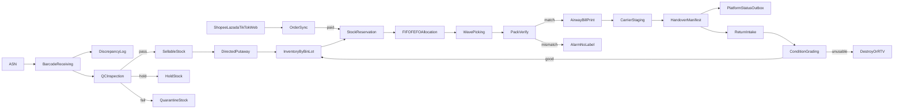

# Fulfillment WMS v2 (ร่างโดย Claude Sonnet 5.5 high)

แทนแผนก่อนหน้า (แผนก่อนหน้าถูกร่างโดยโมเดลสำรอง ไม่ใช่ Sonnet 5.5 high) ตรวจแล้วว่า `node_modules/next/dist/docs/` มีอยู่จริง ผู้ลงมือต้องอ่านก่อนเขียนโค้ดตาม [`AGENTS.md`](AGENTS.md)

**ขอบเขต v1:** ระบบปฏิบัติงานจริง สองภาษา TH/EN ใช้ข้อมูลจำลอง (seed) เก็บใน `localStorage` สแกนบาร์โค้ดผ่านช่องกรอก (Enter = จบการสแกน) พร้อมแผง "Scan simulator" สำหรับสาธิต ไม่ต่อ API มาร์เก็ตเพลส/ขนส่งจริง ไม่มีเครื่องพิมพ์ความร้อนจริง ไม่มี auth และมีคลังเดียว

## ข้อเท็จจริงจากรีโป

- Next 16.4.4, React 19.3, Tailwind 4, bun; [`next.config.ts`](next.config.ts) เปิด `cacheComponents` และ `partialPrefetching`
- `building.md` ยืนยันว่า `Math.random()`, `new Date()`, `crypto.randomUUID()` ตอน render ทำให้ build ล้ม
- [`app/globals.css`](app/globals.css) ยังมี `prefers-color-scheme: dark` และ Arial ต้องลบ; [`app/layout.tsx`](app/layout.tsx) ใช้ Geist ที่ไม่มีอักษรไทย
- ต้องเพิ่ม `zustand` (runtime) และ `vitest` (dev) ส่วน Code128 เขียนเอง ~80 บรรทัด หรือใช้ `jsbarcode`

## ภาพรวมข้อมูลไหลข้ามโมดูล



## Information architecture

ไม่ใส่ locale ใน URL (ถ้าใช้ `app/[lang]` ต้องห่อ `params` ด้วย `<Suspense>` ทุกหน้า) ภาษาเป็น client state `/` redirect ไป `/console` ผ่าน `next.config.ts` ใช้ route group `(console)` กับ `(pda)`

**เดสก์ท็อป `/console/...`** (ไซด์บาร์พื้น ink + ตัวชี้ active สีทอง; ท็อปบาร์มีสลับภาษา ช่องสแกนรวม สถานะ outbox และปุ่มรีเซ็ตข้อมูลเดโม)

- `/console` ภาพรวม / Dashboard
- `/console/inbound` รับสินค้า, `asn/[asnId]` รับตาม ASN, `discrepancies` ส่วนต่าง, `qc` ตรวจคุณภาพ
- `/console/inventory` สต็อกคงคลัง, `inventory/quarantine` กักกัน/พัก
- `/console/locations` ผังตำแหน่ง Zone-Aisle-Rack-Shelf-Bin, `/console/putaway` งานจัดเก็บ
- `/console/orders` + `[orderId]` คำสั่งซื้อ, `/console/waves` รอบหยิบ
- `/console/pack` + `pack/bench` โต๊ะแพ็ก (เต็มจอ)
- `/console/shipping/staging` จัดเรียงตามขนส่ง, `shipping/manifests` + `[manifestId]` ใบส่งมอบ/เซ็นรับ
- `/console/returns` + `[returnId]` คืนสินค้า
- `/console/integrations/outbox` ส่งสถานะไปแพลตฟอร์ม, `/console/dev/barcodes` แผ่นบาร์โค้ดทดสอบ, `/console/settings` ตั้งค่า

**PDA `/pda/...`** (คอลัมน์เดียว พื้น ink ปุ่ม >= 56px แถบปุ่มด้านล่าง)

- `/pda` เมนู, `receive/[asnId]`, `putaway/[taskId]`, `pick/[waveId]`, `returns/[returnId]`

สลับภาษา: segmented control "ไทย | English" (`aria-pressed`) ทั้งคอนโซลและ PDA เก็บใน store

## โมเดลข้อมูล (สรุป) — [`lib/domain/types.ts`](lib/domain/types.ts)

- Master: `Sku` (barcodes, dims, weight, velocity A/B/C, tracksLot/Expiry), `Supplier`, `LocationNode`, `Bin` (barcode ป้าย, zoneType, ขนาด/น้ำหนักสูงสุด, `ergonomics`, `pickSeq`)
- Stock: `StockRow` (sku+lot+bin+status, `qty`, `qtyAllocated`), `LedgerEntry` (ring buffer)
- สถานะสต็อก: `pending_qc | sellable | hold | quarantine | return_pending | repack | rtv | destroy`
- Inbound: `PurchaseOrder`, `Asn`/`AsnLine`, `ReceiptLine`, `Discrepancy` (short/over/wrong_item/damaged/no_asn_line), `QcInspection`
- Putaway: `PutawayTask` (suggestions พร้อมเหตุผล, ต้องสแกนสินค้า+ป้ายช่องครบ)
- Orders: `Order` (channel, payment, carrier, shipBy), `Reservation` (ล็อกระดับ SKU เมื่อชำระ), `Allocation` (ล็อกระดับ lot+bin)
- Pick/Pack: `Wave` (strategy: single_item_envelope / multi_item_envelope / large_box), `PickTask`, `Tote`, `PackSession` (mismatches, `redLightOn`)
- Shipping: `Shipment`, `CarrierConfig` (cut-off, prefix), `Manifest` (ลายเซ็น), `OutboxEvent`
- Returns: `ReturnOrder`/`ReturnLine` (grade A/B/C, disposition), `RtvClaim`
- ID ใช้ `nextId(state, "ord")` จากตัวนับใน store ห้ามสุ่ม

State machine อยู่ใน [`lib/domain/machines.ts`](lib/domain/machines.ts) เป็นตารางทรานซิชัน ทุก action เรียก `assertTransition` และมีเทสต์ว่าทรานซิชันผิดต้อง throw หลัก ๆ:

- Order: `awaiting_payment → paid_reserved → allocated → in_wave → picking → picked → packing → packed → ready_to_ship → handed_over` (ยกเลิกได้ก่อน `packed`; สต็อกไม่พอไป `awaiting_stock`)
- Pack: `open → verifying → verified → label_issued → closed`; สแกนผิดเข้า `blocked`
- Manifest: `draft → scanning → awaiting_signature → handed_over` (ห้ามส่งมอบถ้ายังมีพัสดุไม่สแกนและไม่ระบุ exception)

## State และกติกาธุรกิจ

**Store:** Zustand + `persist` (`skipHydration: true`) key `wms:v1` พร้อม `version`/`migrate`; ลายเซ็น PNG แยกที่ `wms:signatures`; ledger/scan log จำกัด 1500/500 รายการ; ดัก quota เต็ม; sync ข้ามแท็บด้วย event `storage` (last-write-wins, ระบุเป็นข้อจำกัด)

**Hydration ภายใต้ cacheComponents:**

- Server component ไม่อ่าน store และไม่เรียกนาฬิกา/สุ่ม; ส่วนโต้ตอบเป็น `"use client"`
- store เริ่มจาก state ว่าง แล้ว `<StoreProvider>` เรียก `rehydrate()` + seed ใน `useEffect`; ใช้ `useHydrated()` แสดง skeleton
- รอบ render แรกเป็น `th` เสมอ แล้วค่อยใช้ภาษาที่เก็บไว้ (`<html lang="th" suppressHydrationWarning>`)
- เวลา/ID ใช้ได้เฉพาะใน action, event handler, effect ผ่าน `lib/clock.ts`
- หน้า `[id]` ให้ page เป็น synchronous แล้วส่ง `params.then(...)` ใน `<Suspense>` ตามแพตเทิร์นใน `interactive-apps.md`

**Domain เป็นฟังก์ชันบริสุทธิ์** `fn(state, input): Result<Patch, DomainError>` เรียกใน `set()` เดียว (atomic) และมี vitest

**ล็อกสต็อก:**

- ATP(sku) = sellable ในโซน storage/pickface − reservation ที่ active − `qtyAllocated`
- `markPaid` ตรวจ ATP ทุกบรรทัด ถ้าพอทั้งหมดจึงสร้าง reservation (all-or-nothing) ไม่พอไป `awaiting_stock`; ตรวจและจองในการกระทำเดียวกัน จึง oversell ไม่ได้
- Allocate: ตัดล็อตที่อายุเหลือน้อยกว่า `minShelfLifeDays`; FEFO เมื่อ `tracksExpiry` ไม่งั้น FIFO (`receivedAt`); tie-break ด้วย `pickSeq` ต่ำสุด
- ยกเลิก: ปล่อย reservation/allocation; ถ้าหยิบแล้วสร้างงาน return-to-bin
- Short pick: จัดสรรใหม่จากแถว/ล็อตถัดไป ไม่มีก็ `awaiting_stock`
- สต็อกเข้า (QC ผ่าน/restock) จะ retry ออเดอร์ `awaiting_stock` ตามลำดับ `paidAt`

**QC และกักกัน:** รับเข้าเป็น `pending_qc`; QC แยกเป็น sellable/hold/quarantine ผลรวมต้องเท่ายอดรับ; เฉพาะ `sellable` ได้งาน putaway และนับใน ATP; การปล่อยของต้องมีเหตุผลและลง ledger

**Directed putaway:** กรองช่องที่ active ใส่ขนาด/น้ำหนักได้ แล้วให้คะแนน: velocity A บนช่อง `golden` +50 / `normal` +20; velocity C บนช่อง `high`/`floor` +30; รวม SKU เดิม +25; `pickSeq` ต่ำสำหรับ A สูงสุด +15; แสดง top 3 พร้อมเหตุผล TH/EN

**Scan validation:** [`lib/scan/parse.ts`](lib/scan/parse.ts) จำแนกด้วย prefix `LOC:`/`ORD:`/`TOT:`/`ASN:`/`RMA:`/`TRK:` หรือ EAN; [`lib/scan/validate.ts`](lib/scan/validate.ts) รับ expectation ของแต่ละขั้น เช่น putaway ต้องสแกนสินค้าก่อนแล้วจึงป้ายช่อง, คืนสินค้าเกรด A ต้องลงช่องเดิม (ไม่ตรงต้อง override พร้อมเหตุผล); ความต่างของรุ่น/สี/ไซส์ต้องบอกว่า "คาดว่า vs สแกนได้" ทั้งสองภาษา

**เสียง/ไฟแดงจำลอง:** Web Audio (สร้างหลัง user gesture) ok = บี๊ป 880 Hz, error = buzz ต่ำสองครั้ง ~400 ms; ไฟแดง `RedBeacon` + แบนเนอร์ `role="alert"`; `issueLabel` ใน domain คืน `LABEL_BLOCKED` ถ้ายังไม่ `verified` หรือ `redLightOn` (บล็อกที่ domain ไม่ใช่แค่ปิดปุ่ม)

**เส้นทางหยิบ:** ใช้ `pickSeq` แบบ serpentine (zone → aisle → rack ขึ้น/ลงสลับ → shelf) เรียง PickTask ตามนั้น ไม่ทำ TSP จริง

## หน้าจอหลักตามโมดูล

PDA ทุกหน้ามีช่องสแกนด้านบน (autofocus, `inputmode="none"`, refocus เมื่อ blur) แบนเนอร์ขั้นตอนปัจจุบัน และแถบผลลัพธ์

1. **Inbound & QC** — รายการ ASN, สแกนรับ (เพิ่มยอดบรรทัดที่ตรง), กรอก lot/expiry ถ้าต้อง, ปิด ASN ต้องรับทราบ discrepancy ก่อน; สินค้าไม่อยู่ใน ASN แสดงแผงแดงและให้ลง discrepancy ไม่เพิ่มเงียบ ๆ; QC board มี checklist และตัวเลือกจำนวน pass/hold/quarantine; แบนเนอร์ "Hold และ Quarantine ไม่ใช่สต็อกขาย"
2. **Putaway** — ผังตำแหน่งแบบต้นไม้; PDA แสดงช่องแนะนำพร้อมพาธ "โซน A › ทางเดิน 01 › ชั้น 03 › ช่อง 04"; สแกนสินค้า + ป้ายช่องครบจึงจบ; สแกนช่องอื่นต้องมีเหตุผล override; ช่องเต็มน้ำหนัก/ปริมาตรถูกบล็อก
3. **Orders & Inventory** — ปุ่ม "นำเข้าคำสั่งซื้อ" (จำลอง sync), Mark paid / Buyer cancel ต่อออเดอร์; ตารางสต็อกแสดง On hand/Sellable/Reserved/Allocated/ATP/Hold/Quarantine และลำดับล็อตตาม FEFO/FIFO; ออเดอร์สองใบแย่งชิ้นสุดท้าย ใบที่สองเป็น `awaiting_stock` พร้อมชิป "Short by n"
4. **Pick & Pack** — "Build waves" จัดกลุ่มซองเดี่ยว / ซองหลายชิ้น / กล่องใหญ่ แล้ว Release สร้าง PickTask และ tote; PDA หยิบทีละจุด (สแกนช่องแล้วสินค้า) พร้อมแถบความคืบหน้า; โต๊ะแพ็กสแกนซ้ำ ผิดแล้วไฟแดง + buzz + ปุ่มพิมพ์ AWB ใช้ไม่ได้ ผิดครบ 3 ครั้งต้อง supervisor override; ครบแล้วเลือกขนาดกล่องและพิมพ์ AWB ขนาด 100×150 mm ผ่าน `window.print()` พร้อม Code128
5. **Shipping & Handover** — ตารางเลน ขนส่ง × cut-off พร้อมนับถอยหลัง; สแกนเลขพัสดุแล้วบอกเลนที่ต้องวาง; สร้าง manifest จากเลน; พัสดุที่ไม่ได้สแกนต้องระบุ missing/damaged; ช่องลายเซ็น (canvas) + ชื่อคนขับ/ทะเบียน; เมื่อเซ็นสร้าง `shipped` outbox ต่อออเดอร์; หน้า outbox มี retry และตัวเลือก "Fail next push"
6. **Returns** — สแกน RMA/เลขพัสดุตีกลับดึงออเดอร์เดิม; เกรด A (สมบูรณ์) → restock ลงช่องเดิม, B (กล่องพัง) → repack แล้ว restock, C (ใช้ไม่ได้) → destroy หรือ RTV claim; สแกนสินค้าที่ไม่ได้อยู่ในออเดอร์ถูกปฏิเสธ; restock คงล็อตและ `receivedAt` เดิม

## Design system (Tailwind v4 ใน [`app/globals.css`](app/globals.css))

```css
@theme {
  --color-ink: #171717;
  --color-gold: #c6a15b;
  --color-gold-deep: #8a6a32;
  --color-silver: #e6e6e6;
  --color-silver-metal: #b9b9b9;
  --color-muted: #5e5e5e;
  --color-white: #ffffff;
  --color-danger: #b3261e;   /* error เท่านั้น */
  --color-success: #1b7a3d;  /* success เท่านั้น */
}
```

- ลบ `prefers-color-scheme` และ Arial; พื้นมืดทำเป็น `bg-ink` เฉพาะส่วน (ไซด์บาร์, PDA)
- ฟอนต์: `IBM_Plex_Sans_Thai` (subsets thai+latin) + `IBM_Plex_Mono` สำหรับบาร์โค้ด/เลขพัสดุ; line-height >= 1.5 กันวรรณยุกต์ถูกตัด; ตรวจชื่อฟอนต์ใน `next/font/google` ตั้งแต่ Phase 0
- การจับคู่: พื้นขาว/silver สลับ + ตัวอักษร ink + คำบรรยาย muted; ปุ่มหลักพื้น gold ตัวอักษร ink; ลิงก์บนพื้นสว่าง gold-deep; ส่วนมืด ink + ขาว + accent gold; เส้นแบ่ง silver-metal
- คอมโพเนนต์ใน `components/ui`: `Button`, `Input`, `Select`, `Stepper`, `ScanInput`, `Badge`, `StatusPill`, `DataTable`, `Tabs`, `Dialog`, `Drawer`, `Toast`, `Card`, `Section`, `Timeline`, `PathBreadcrumb`, `LanguageSwitcher`, `ScanFeedbackHost`, `RedBeacon`, `BarcodeSvg`, `SignaturePad`, `PrintSheet`, `ScanSimulator`

**Contrast (ค่าประมาณที่ผู้ร่างคำนวณ ต้องตรวจซ้ำตอน build):**

- ผ่าน: ink บนขาว ~17.9:1; muted บนขาว ~6.5:1; ink บน gold ~7.4:1; gold-deep บนขาว ~5.0:1
- ไม่ผ่าน: gold บนขาว ~2.4:1 (ห้ามใช้เป็นตัวอักษร/ไอคอนสื่อความหมาย/ขอบบาง); gold-deep บน silver ~4.0:1 (ใช้ ink แทน หรือใช้ตัวหนาใหญ่ >= 18.5px); silver-metal บนขาว ~2.0:1 (เส้นตกแต่งเท่านั้น)
- ขอบช่องกรอก silver #e6e6e6 บนขาวเหลือ ~1.2:1 ต่ำกว่าเกณฑ์ 3:1 ของ WCAG — ข้อกำหนดของคุณระบุ silver แต่แผนเสนอให้ช่องสแกน/ช่องสำคัญใช้ขอบ muted 1px (silver ใช้เป็นสีพื้น/hover) **ต้องให้คุณตัดสินใจก่อนสร้างฟอร์ม**
- สถานะ (hold, quarantine, pending) แยกด้วยรูปทรง ขอบ ไอคอน และข้อความ ไม่ใช้สีใหม่; แดง/เขียวเฉพาะ error/success; ไม่พึ่งสีอย่างเดียว; เคารพ `prefers-reduced-motion`; เป้าสัมผัส 44px (คอนโซล) / 56px (PDA)
- งานพิมพ์ AWB/manifest เป็นดำบนขาว ไม่มีทอง

## โครงสร้างไฟล์

- `app/layout.tsx`, `app/globals.css`, `app/page.tsx` (redirect), `app/(console)/console/...`, `app/(pda)/pda/...` ตามตาราง IA
- `components/ui/`, `components/shell/` (`ConsoleSidebar`, `Topbar`, `PdaTopbar`, `LanguageSwitcher`, `StoreProvider`, `ClientOnly`), `components/scan/`, `components/print/` (`AirwayBill`, `ManifestSheet`, `BarcodeSheet`), `components/features/{inbound,putaway,locations,orders,inventory,waves,pack,shipping,returns}/`
- `lib/i18n/` (`th.ts` ใช้ `satisfies Dict` เพื่อให้ key ครบสองภาษาเช็กตอน type-check), `lib/domain/`, `lib/scan/`, `lib/feedback/`, `lib/barcode/code128.ts`, `lib/store/` (store, actions, selectors, persist, seed, sim), `lib/clock.ts`, `tests/`

## ลำดับทำ (ใช้งานได้ทุกเฟส)

- **Phase 0 Foundation:** อ่านเอกสาร Next 4 ไฟล์ (`building`, `instant-navigation`, `internationalization`, `interactive-apps`); เพิ่ม deps, โทเคน, ฟอนต์, layout, `StoreProvider`, i18n, UI kit หลัก, เชลล์ console/PDA; **รัน `bun run build` ทันที** กับหน้าทดสอบที่ใช้ store + `useSearchParams` + route `[id]`
- **Phase 1:** store/persist/seed (~25 SKU, ~60 bin ใน 5 โซน, 4 ซัพพลายเออร์, 6 ASN, 14 ออเดอร์), หน้า Locations, Inventory (อ่านอย่างเดียว), แผ่นบาร์โค้ด, รีเซ็ตข้อมูล
- **Phase 2 Inbound & QC:** ASN, PDA receive, discrepancies, QC, กักกัน, ชั้นสแกน + เสียง + simulator
- **Phase 3 Putaway:** engine แนะนำช่อง, PDA สองสแกน
- **Phase 4 Orders & allocation:** sync จำลอง, reserve, ATP, FIFO/FEFO, ยกเลิก, retry `awaiting_stock`
- **Phase 5 Waves/Pick/Pack:** wave planner, PDA pick, โต๊ะแพ็ก + ไฟแดง + บล็อกใบปะหน้า, AWB + Code128
- **Phase 6 Shipping:** staging, manifest, ลายเซ็น, outbox + retry
- **Phase 7 Returns:** intake, เกรด, restock/repack/destroy/RTV
- **Phase 8 Hardening:** vitest สำหรับ domain, a11y (คีย์บอร์ด, contrast, reduced motion), ตรวจคำ TH/EN ทั้งหมด, จัดการ storage quota, ตรวจ print CSS

หากเวลาไม่พอ ให้ตัดตามลำดับ: ขัดเกลา Phase 7 → UI retry ของ outbox → drag-and-drop ใน wave; **ห้ามตัด** การบล็อกใบปะหน้าที่โต๊ะแพ็ก, allocation engine และ putaway สองสแกน

## นอกขอบเขต v1

API จริงของมาร์เก็ตเพลส/ขนส่ง (OAuth, webhook, เลขพัสดุจริง), driver เครื่องพิมพ์ ZPL/TSPL, กล้อง/SDK PDA จริงและโหมดออฟไลน์, auth/บทบาท/PIN หัวหน้างาน (override เป็นแค่การกรอกเหตุผล), หลายคลัง/หลายผู้ใช้/DB ฝั่งเซิร์ฟเวอร์, cycle count, replenishment, kitting, serial number, cartonization, TSP จริง, บัญชี/COD reconciliation, ภาษาอื่นนอกจาก TH/EN

## จุดเสี่ยงที่ต้องตรวจก่อน

- **cacheComponents:** ยืนยันด้วย build ใน Phase 0 ว่าข้อห้าม clock/random ครอบคลุม Client Component และแพตเทิร์น `params.then()` ใน `<Suspense>` ใช้ได้; หน้า `[id]` ที่ข้อมูลอยู่ฝั่ง client อาจต้องใช้ `generateStaticParams` หรือสำรองเป็น `?id=` บนหน้าเดียว
- **`partialPrefetching` / `experimental.agentFeedback`:** เป็นของใหม่ ถ้าขัดกับหน้า client-only ให้ถอดออกได้ (ไม่จำเป็นต่อโปรเจกต์)
- **ชนิด `LayoutProps<"/">`/`PageProps`:** ตรวจว่าถูก generate ครอบคลุม route group และ dynamic segment ซ้อน
- **localStorage:** เพดาน ~5 MB และเขียนแบบ sync ทุก action → debounce การ persist; ทดสอบกับ ledger ~1500 แถวและ 50 ออเดอร์
- **เสียง:** `AudioContext` ต้องเริ่มหลัง user gesture มีปุ่ม "เปิดเสียง" บน PDA
- **สแกนเนอร์ USB:** ตรวจ `inputmode="none"` + autofocus บน iOS/Android/เดสก์ท็อป และ dialog ต้องไม่แย่งโฟกัส
- **ฟอนต์ไทย:** ตรวจวรรณยุกต์ถูกตัดในแถวตารางแน่น ๆ และในงานพิมพ์ AWB
- **Code128:** ตรวจ encoder กับเครื่องสแกนจริง/แอปสแกนบนมือถือเทียบกับที่พิมพ์
- **Invariants ของสต็อก:** `qtyAllocated <= qty`, ผลรวม QC = ยอดรับ, ATP ไม่ติดลบ → ใส่ `assertInvariants(state)` เรียกหลังทุก action ในโหมด dev
- **แท็บซ้อน:** สองแท็บเขียนทับกันได้ (บันทึกเป็นข้อจำกัด)
